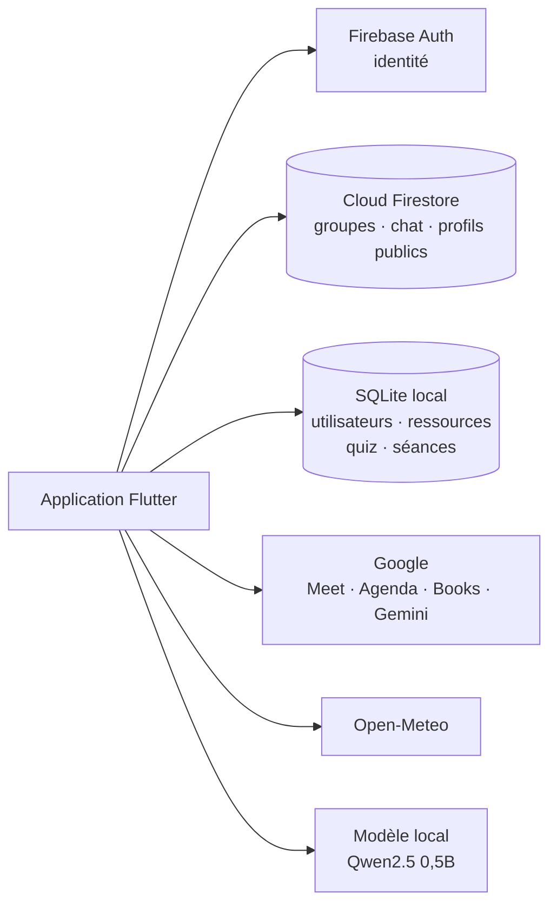

<div align="center">

# StudyMate

**L'application mobile de révision collaborative pour étudiants et enseignants.**

Cours, groupes d'étude, quiz adaptatifs et séances de révision planifiées au bon moment, au même endroit.


</div>

---

## Sommaire

1. [Présentation](#présentation)
2. [Fonctionnalités](#fonctionnalités)
3. [Architecture](#architecture)
4. [Démarrage rapide](#démarrage-rapide)
5. [Configuration](#configuration)
6. [Données de démonstration](#données-de-démonstration)
7. [Tests](#tests)
8. [Sécurité](#sécurité)
9. [Contribuer](#contribuer)
10. [Pistes d'amélioration](#pistes-damélioration)
11. [Équipe](#équipe)

## Présentation

Réviser seul est difficile, et réviser à plusieurs demande de l'organisation : retrouver les bons cours, trouver un groupe, se mettre d'accord sur une date. **StudyMate** réunit ces étapes dans une seule application :

- les **étudiants** retrouvent leurs cours, rejoignent des groupes d'étude, s'entraînent avec des quiz qui s'adaptent à leur niveau et réservent des séances de révision ;
- les **enseignants** (vérifiés à l'inscription) partagent des ressources et animent des séances ;
- l'application s'occupe de la logistique : lien de visioconférence, agenda, rappels, météo, et détection des conflits d'horaires.

L'interface est organisée en cinq onglets : **Accueil**, **Ressources**, **Groupes**, **Séances** et **Profil**.

## Fonctionnalités

### Comptes et sécurité
- Inscription **étudiant** ou **enseignant**, connexion par e-mail (compte vérifié) ou par Google, mot de passe oublié.
- **Vérification des enseignants** : le justificatif fourni est analysé par OCR (ML Kit) avant validation.
- **Verrouillage biométrique** par empreinte, activable depuis le profil.
- Profil modifiable avec photo. Les autres membres d'un groupe voient un profil public limité.

### Ressources
- Ajout de cours (texte ou fichier PDF, PowerPoint…) avec matière, auteur et **visibilité** : publique, privée ou réservée à un groupe.
- Ressources gratuites ou payantes.
- **Résumés et flashcards générés par IA** (Google Gemini) à partir du contenu du cours.

### Groupes d'étude et chat
- Création de groupes avec niveau, matière et nombre maximal de membres ; **filtres** de recherche.
- **Demandes d'adhésion** à valider par le responsable du groupe, avec notifications en temps réel.
- **Assistant IA** pour rédiger la description d'un groupe (ton professionnel, convivial ou motivant) et **suggestions de livres** via Google Books.
- **Chat de groupe** : messages, pièces jointes, réactions, messages épinglés, galerie des médias et **sondages**.

### Quiz et carte des connaissances
- Création de quiz à la main ou **générés par IA** (Gemini ou OpenRouter), et quiz en ligne (Open Trivia).
- **Difficulté adaptative** : le niveau des questions suit les résultats de l'étudiant. Historique et résultats détaillés.
- **Carte des connaissances** : chaque question est reliée à des concepts, la maîtrise de chaque concept est calculée, et l'application **recommande quoi réviser ensuite**.
- Un petit modèle de langage **local** (Qwen2.5-0.5B, via llama.cpp) enrichit la carte sans service externe.

### Séances de révision
- **Proposer et réserver** des séances en ligne ou en présentiel, avec places limitées. Seul l'organisateur peut modifier ou supprimer sa séance.
- **Google Meet** : création du lien depuis l'application, type d'accès, fin de la réunion en cours, gestion des invités.
- **Google Agenda** : ajout d'une séance à son calendrier, mise à jour et suppression automatiques, et page **Mon agenda** qui mêle événements Google et séances réservées.
- **Créneaux communs** : chaque participant indique ses plages libres de la semaine ; l'application propose les créneaux où tout le monde est disponible, ou les meilleurs compromis.
- **Détection des conflits d'horaires** : deux séances au même moment, un participant indisponible ou un événement de l'agenda qui chevauche. L'utilisateur est averti et peut confirmer.
- **Météo** : pour une séance en présentiel, la météo au début et à la fin (Open-Meteo), avec un conseil si besoin.
- **Rappels** : notification 30 minutes avant chaque séance proposée ou réservée, et panneau de notifications avec test d'envoi.

## Architecture

### Vue d'ensemble



- **Firebase Auth** est la seule source d'identité. Les **règles Firestore** revérifient chaque écriture côté serveur (propriétaire, membre, auteur, capacité, sondage ouvert).
- **SQLite** stocke localement les utilisateurs, les ressources, les quiz et les séances.
- Le code est organisé **par fonctionnalité** : chaque module regroupe ses modèles, ses services, ses écrans et son stockage.

### Structure du dépôt

```
lib/
├── main.dart                 Point d'entrée, authentification, navigation
├── core/                     Thème, widgets communs, services et configuration partagés
└── features/
    ├── gestion_user/         Inscription, connexion, profil, OCR, biométrie
    ├── home/                 Accueil
    ├── resources/            Cours, résumés et flashcards IA
    ├── groups/               Groupes d'étude, livres, assistant de description
    ├── group_chat/           Messages, pièces jointes, sondages
    ├── quizzes/              Quiz et carte des connaissances (+ LLM local)
    ├── seances/              Séances : liste, formulaire, stockage
    ├── availability/         Disponibilités et créneaux communs
    ├── conflicts/            Détection des conflits d'horaires
    ├── calendar/             Google Agenda et « Mon agenda »
    ├── meet/                 Google Meet
    ├── weather/              Météo d'une séance en présentiel
    └── notifications/        Rappels et panneau de notifications
test/                         Tests unitaires et de widgets
firestore.rules               Règles de sécurité Firestore
firestore_tests/              Tests des règles (émulateur local)
models/kg_llm/                Modèle de langage local (Git LFS)
```

## Démarrage rapide

### Prérequis
- [Flutter](https://docs.flutter.dev/get-started/install) 3.47 ou plus récent (Dart `^3.13.4`)
- Android Studio avec le SDK Android, et un JDK 17
- Un téléphone Android (débogage USB ou sans fil) ou un émulateur, **Android 8.0 (API 26) minimum**
- [Git LFS](https://git-lfs.com), seulement pour le modèle de langage local

### Installation et lancement

```bash
git clone https://github.com/emna03/Projet-Mobile.git
cd Projet-Mobile
git lfs install && git lfs pull    # modèle local des quiz (facultatif)
flutter pub get
flutter run --dart-define-from-file=dart_defines.json
```

Sans clés d'API, l'application démarre quand même : les fonctions d'IA sont alors désactivées ou demandent une clé. Voir la section suivante pour créer `dart_defines.json`.

Pour produire un APK de test : `flutter build apk --debug`.

## Configuration

### Clés d'API

Crée un fichier `dart_defines.json` à la racine (il est **ignoré par Git**, ne le commite jamais) :

```json
{
  "GEMINI_API_KEY": "ta-clé-gemini",
  "IMGBB_API_KEY": "ta-clé-imgbb"
}
```

| Variable | Rôle | Obligatoire |
|---|---|---|
| `GEMINI_API_KEY` | Résumés, flashcards, descriptions de groupe et quiz générés par IA. À défaut, l'application utilise Gemini via Firebase, ou demande la clé dans l'application. | Non |
| `GEMINI_MODEL` | Modèle Gemini à essayer en premier. | Non |
| `GEMINI_PROXY_URL` | Adresse d'un proxy qui garde la clé côté serveur. | Non |
| `OPENROUTER_API_KEY`, `OPENROUTER_MODEL`, `OPENROUTER_PROXY_URL` | Fournisseur d'IA alternatif pour les quiz. | Non |
| `GOOGLE_BOOKS_API_KEY` | Quota Google Books de ton propre projet (1 000 requêtes par jour). | Non |
| `IMGBB_API_KEY` | Hébergement des photos de profil et des justificatifs. Une clé par défaut est fournie (voir [Sécurité](#sécurité)). | Non |
| `QUIZ_USE_MEMORY` | Avec `lib/features/quizzes/quiz_demo_main.dart`, lance le module Quiz seul avec un stockage en mémoire (démos). | Non |

### Connexion Google, Google Meet et Google Agenda

1. Récupère l'empreinte **SHA-1** de ta clé de debug :
   ```bash
   keytool -list -v -keystore ~/.android/debug.keystore -alias androiddebugkey -storepass android
   ```
2. Ajoute-la dans la console Firebase (Paramètres du projet, application Android). Sans elle, Google refuse la connexion.
3. Dans Google Cloud (même projet), active les API **Google Meet REST** et **Google Calendar**, et déclare les niveaux d'accès `meetings.space.created` et `calendar.events`.
4. Ces niveaux d'accès sont sensibles : tant que l'application n'est pas validée par Google, un écran « application non validée » s'affiche à la première connexion. Choisis « Avancé », puis continue.

### Modèle de langage local (quiz)

Le fichier `models/kg_llm/qwen2.5-0.5b-instruct-q4_k_m.gguf` (environ 491 Mo) est versionné avec **Git LFS**. Après `git lfs pull`, suis le guide d'installation sur le téléphone : [`MODEL_INSTALL.md`](lib/features/quizzes/knowledge_graph/services/local_llm/MODEL_INSTALL.md).

### Règles Firestore

Les règles sont dans `firestore.rules`. Pour les déployer :

```bash
firebase deploy --only firestore:rules
```

## Données de démonstration

Pour essayer les séances sans rien saisir, ouvre l'onglet **Séances** et touche **« Charger des séances d'exemple (test) »** en bas de la liste. Cela ajoute cinq séances à venir et quatre participants fictifs (Sarah Ben Ali, Yassine Trabelsi, Ines Gharbi, Amine Khaled) avec leurs disponibilités. Une des séances chevauche volontairement une autre, pour montrer la détection de conflit.

Ces participants **ne sont pas des comptes de connexion** : ils n'existent que dans la base locale du téléphone. Le même bouton devient **« Supprimer les séances d'exemple »** pour tout effacer sans toucher à tes vraies données. Pense à les supprimer après le test : elles déclenchent de vrais rappels.

## Tests

```bash
flutter analyze          # analyse statique
flutter test             # tests unitaires et de widgets
```

Les tests couvrent notamment les appels aux API Google et à la météo (réponses simulées), le calcul des créneaux communs, la détection des conflits, les rappels, les quiz et la carte des connaissances.

Les **règles Firestore** se testent avec l'émulateur local, sans rien déployer :

```bash
cd firestore_tests
npm install
npm test
```

## Sécurité

- **Identité** : Firebase Auth uniquement. Les règles Firestore revérifient chaque écriture, l'application ne suffit pas à protéger les données.
- **Clés d'IA** : jamais écrites dans le code. Elles viennent de `dart_defines.json` (ignoré par Git) ou d'une saisie dans l'application.
- **Point d'attention** : une clé ImgBB par défaut est embarquée dans l'application (`lib/core/config/imgbb_config.dart`). Une clé intégrée à une application mobile reste extractible : remplace-la par la tienne avec `IMGBB_API_KEY` avant toute diffusion.
- **Biométrie** et stockage sécurisé (`flutter_secure_storage`) pour les données sensibles de session.

## Contribuer

1. Crée une **branche par fonctionnalité** à partir de `main` (`feat/…`, `fix/…`, `docs/…`).
2. Fais des commits courts préfixés : `feat:`, `fix:`, `docs:`, `test:`.
3. Avant d'ouvrir ta pull request, vérifie que `flutter analyze` ne signale aucune erreur et que `flutter test` passe.
4. Ouvre une **pull request vers `main`** et attends une relecture avant de fusionner.

Ne commite jamais de clé d'API, de mot de passe ni de fichier `dart_defines.json`.

## Pistes d'amélioration

- **Partager les séances entre appareils** : elles sont aujourd'hui stockées sur le téléphone, ce qui limite la réservation à un seul appareil. Les déplacer dans Firestore permettrait de vraiment réserver à plusieurs.
- **Faire valider l'application par Google** pour supprimer l'écran « application non validée » de Google Meet et Agenda.
- **Signer la version de production** : la compilation `release` utilise encore la clé de debug.
- **Ajouter une intégration continue** (analyse et tests à chaque pull request).

## Équipe

Projet réalisé en équipe. Contributeurs au dépôt : emna03, ILYES, nacef20, aminebarrani, Rouamessoudi et wolftn14-droid.
